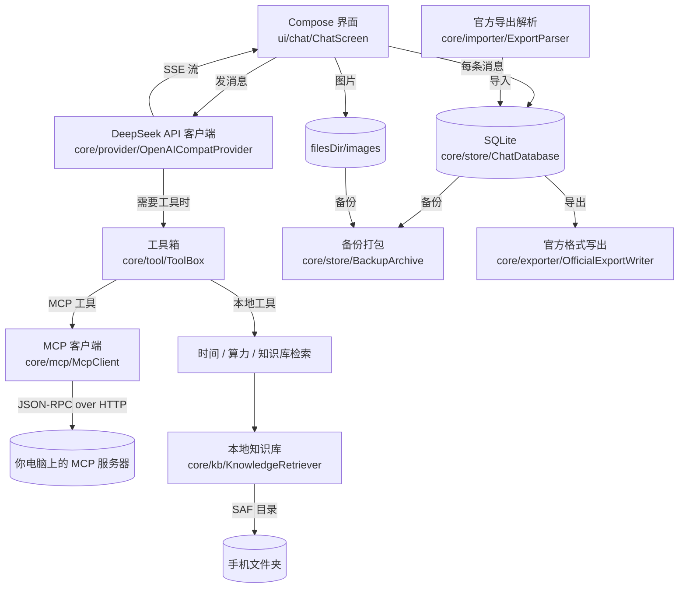

# 架构说明

一句话：**单模块 Android App，没有后端，所有状态都在手机上**。界面用 Compose，网络用 OkHttp + 手写 SSE，存储用手写 SQLite（不用 Room），JSON 全部 `org.json`（不用 kotlinx-serialization）。

## 为什么这么选

| 决定 | 原因 |
|---|---|
| 不引 Room | 注解处理器和这版 AGP 的内置 Kotlin 容易打架，手写 100 行 SQL 反而更省心 |
| 不引 kotlinx-serialization | 只要发请求和拆 SSE，`org.json` 够用，少一个编译插件 |
| 不引 Hilt / Koin | 单模块、状态少，`object` + 构造函数传参就够，依赖注入是负担 |
| 手写 SSE | 官方是 SSE 流式，OkHttp 直接读 body 的 reader 就行，没必要上第三方库 |
| 聊天记录只存本机 | 这是这个项目的卖点，也是隐私承诺 |

## 数据流



## 关键模块

### 1. API 客户端（`core/provider`）

- 请求体：`messages` 数组 + `tools` + `thinking`
- 流式：读 SSE 行，`delta.content` 追加正文，`delta.reasoning_content` 追加思考过程，`delta.tool_calls` 按 `index` 拼碎片
- **官方限制**：`deepseek_web_search` 这类服务端工具和自定义 function 工具不能同时出现（会 400），所以 UI 上「联网」和「工具」互斥
- 错误映射：把 400/401/402/429 翻译成人话（`extractErrorMessage`）

### 2. 工具（`core/tool` + `core/mcp`）

- 工具名必须匹配 `^[a-zA-Z0-9_-]+$` —— 这是个踩过的坑：MCP 服务器给的中文工具名要 `slug()` 成 ASCII
- 危险判定：名字里含 删/写/执行/shell/转账… 或**不认识的工具**，一律弹确认框且不能默认放行
- MCP 工具列表缓存 120 秒（成功）/30 秒（失败），避免每轮都去连

### 3. 存储（`core/store`）

- `ChatDatabase`：`conversation` + `message` 两张表，v7 起补了三个索引
- 消息里的附件存 JSON 字符串（图片 `image_json`、来源 `sources`、工具 `tools`），不额外建表
- 图片文件落 `filesDir/images/<uuid>.jpg` + `_t.jpg` 缩略图；数据库里存绝对路径
- 备份 = zip（`harness.db` + `images/` + 清单），恢复时会把图片路径**改写成本机路径**（跨包名搬家）

### 4. 官方格式互通（`core/importer` / `core/exporter`）

DeepSeek 导出的结构（`export_format_version: 3`）：

```
manifest.json            {"export_format_version":3}
user.json                user_id / email / mobile / oauth_profiles
chat_session_index.json  [{id,title,pinned,message_count,inserted_at,updated_at}]
chat_sessions/<uuid>.json
    {id,title,pinned,current_message_id,inserted_at,updated_at,messages:[...]}
    message: {id,parent_id,role,status,thinking_enabled,search_enabled,
              accumulated_token_usage,inserted_at,fragments:[...]}
chat_sessions/<uuid>_files/<图片>   FILE 分片里的 export_path 指向这里
```

**要点：消息正文不在 `content` 里，而在 `fragments` 里按类型分片**（`REQUEST` / `RESPONSE` / `THINK` / `TOOL_SEARCH` / `FILE` …）。
这是这个项目最难的一段，也是最值钱的一段：

- 解析器（`ExportParser`）是**纯 Kotlin**，不 import 任何 `android.*`，所以能在电脑上用 JVM 单测
- 导出器（`OfficialExportWriter`）同样纯 Kotlin，测试里跑完整的「真包 → 解析 → 再导出 → 再解析」往返
- 读 zip 用 `ZipFile`（走中央目录）而不是 `ZipInputStream`：官方的图片条目是 "STORED + 数据描述符"，流式读会抛 `only DEFLATED entries can have EXT descriptor`

### 5. 界面（`ui/`）

- `ui/chat/ChatScreen.kt` 是最大的一块（2400+ 行）：会话列表、消息列表、输入区、各种弹窗
- 主题色/气泡色在 `ui/theme/Theme.kt`，气泡语义色通过 `LocalChatPalette` 下发（用户＝淡蓝，助手＝白底）
- 各功能页（账单、诊断、MCP、模板、导入、存储）都是独立 Screen，靠 `ChatScreen` 里一个 boolean 切换

### 6. 启动时的小扫除（`core/store/Housekeeping`）

- 上次崩溃/被杀时卡在 "streaming" 的消息标成 "stopped"
- 清掉 `cacheDir/import`、`cacheDir/export` 里遗留的临时 zip

## 安全相关的约定

- API Key 用 AES-GCM 加密存在 Android Keystore（`core/SecretStore`），**从不落明文、不进日志**
- 备份**故意不包含** API Key（Keystore 是设备+包名绑定的，搬不走）
- 解压备份时只认 `harness.db` / `backup.json` / `images/<单层文件名>`，带 `..` 的条目直接丢弃（有单测）
- 明文 HTTP 只允许本机/局域网地址，其它地方会警告
- 导入的图片标记成 `local:` 前缀，**永远不发给模型**（官方包里没有服务器端 file id，发过去会 400）
